# Proyecto 2

Arquitectura MLOps completa desplegada en un clúster **RKE2 de dos nodos administrado con
Rancher**, para predecir la **readmisión hospitalaria de pacientes diabéticos**
(dataset *Diabetes 130-US hospitals 1999-2008*, 101.766 encuentros) en tres clases:

| Clase | `readmitted` | Significado |
|---|---|---|
| 0 | `NO` | No readmisión |
| 1 | `>30` | Readmisión tardía (más de 30 días) |
| 2 | `<30` | Readmisión temprana (menos de 30 días) |

Flujo:

1. **Airflow** carga el CSV por lotes de 15.000 filas (una ejecución del DAG = un lote) en
   la capa **raw**, valida calidad, limpia y guarda en **clean**, separa train/val/test,
   entrena 3 modelos, los registra en **MLflow** y promueve el mejor con el alias
   `champion`.
2. La **API** (FastAPI) sirve `diabetes_readmission@champion`, lo recarga sola cuando el
   alias cambia y registra cada inferencia en la capa **inference**.
3. **Streamlit** consume solo la API.
4. **Locust** genera carga contra la API desde otro nodo; **Prometheus** recolecta
   `/metrics` de cada réplica y CPU/memoria de los pods, y **Grafana** lo muestra.

## Arquitectura


| VM | IP | Rol |
|---|---|---|
| Instancia 1 (Fabián) | 10.43.97.106 | Rancher + puerta de entrada (no es nodo) |
| Instancia 2 (Cristian Organista) | 10.43.97.105 | Nodo etcd + control plane + worker: datos y entrenamiento |
| Instancia 3 (Cristhian Bolaños) | 10.43.97.92 | Nodo worker: inferencia y observabilidad |

## Estructura

| Carpeta | Contenido |
|---|---|
| [`cluster/`](cluster/README.md) | Pasos en las VMs: Rancher, clúster RKE2, `local-path`, labels |
| [`database/`](database/README.md) | `postgres-data` (StatefulSet) y scripts de creación de schemas/tablas |
| [`minio/`](minio/README.md) | MinIO (StatefulSet) y Job que crea los buckets `mlflows3` y `datasets` |
| [`mlflow/`](mlflow/README.md) | Imagen y Deployment de MLflow + `postgres-mlflow` |
| [`airflow/`](airflow/README.md) | Imagen con el DAG, `values.yaml` de Helm, `postgres-airflow` |
| [`api/`](api/README.md) | API de inferencia (FastAPI, uv) |
| [`streamlit/`](streamlit/README.md) | Interfaz gráfica |
| [`locust/`](locust/README.md) | Imagen de Locust, escenario y `run_levels.sh` |
| [`observability/`](observability/README.md) | Prometheus (RBAC, configuración) y Grafana (provisioning + dashboard JSON) |
| [`notebooks/`](notebooks/eda.ipynb) | Análisis exploratorio y justificación de la limpieza |
| [`scripts/`](scripts) | `build_push.sh`, `deploy.sh`, `port_forward.sh` |

Cada componente tiene un `kustomization.yaml`; el de esta carpeta los une, así todo
(menos Airflow, que va con Helm) se aplica con `kubectl apply -k .`.

Todos los contenedores definen `resources.requests/limits`; además un `LimitRange` en el
namespace cubre los init containers del chart de Airflow.

## Imágenes en Docker Hub

| Imagen | Contenido |
|---|---|
| `crissebasbol/proyecto2-airflow:1.0.0` | `apache/airflow:3.1.8` + DAG + dependencias de ML |
| `crissebasbol/proyecto2-mlflow:1.0.0` | MLflow 3.16.1 con soporte Postgres y S3 |
| `crissebasbol/proyecto2-api:1.0.1` | API FastAPI |
| `crissebasbol/proyecto2-streamlit:1.0.0` | Interfaz Streamlit |
| `crissebasbol/proyecto2-locust:1.0.0` | Locust con el escenario de `/predict` |

Las cinco imágenes están publicadas como repositorios públicos en
[hub.docker.com/u/crissebasbol](https://hub.docker.com/u/crissebasbol), así que los nodos las
descargan directamente sin depender de ninguna máquina local:


## Servicios y puertos

Solo los puertos 8000-8025 están abiertos hacia afuera, así que las UIs se publican con
`kubectl port-forward` desde `10.43.97.106` (`scripts/port_forward.sh`). Dentro del clúster
todos los servicios son `ClusterIP`.

| Servicio | URL | Credenciales |
|---|---|---|
| Rancher | https://10.43.97.106:8001 | `admin` / la definida al instalar |
| Airflow | http://10.43.97.106:8002 | `admin` / `admin` |
| MLflow | http://10.43.97.106:8003 | - |
| Consola MinIO | http://10.43.97.106:8004 | `admin` / `admin123` |
| API (docs) | http://10.43.97.106:8005/docs | - |
| Streamlit | http://10.43.97.106:8007 | - |
| Grafana | http://10.43.97.106:8008 | `admin` / `admin` |
| Prometheus | http://10.43.97.106:8009 | - |
| Locust | http://10.43.97.106:8010 | - |

`kubectl port-forward` a un Service se conecta a **un solo pod**. Para probar balanceo y
carga se usa Locust **dentro del clúster** (llama a `http://api:8000`, que sí reparte entre
réplicas).

## Despliegue paso a paso

### 1. Construir y publicar las imágenes

```bash
docker login
cd proyecto_2
./scripts/build_push.sh 1.0.0
```

Por defecto construye `linux/amd64` (la arquitectura de las VMs). Para un componente:
`./scripts/build_push.sh 1.0.1 api` (y actualizar el tag en su `k8s/deployment.yaml`).

### 2. Preparar el clúster

Seguir [cluster/README.md](cluster/README.md) (Rancher en `.106`, nodos `.105` y `.92`,
`local-path` como StorageClass por defecto y labels `mlops/tier`).

En la siguiente imagen se ve el clúster `mlops` con sus dos nodos en estado `Ready`:
`nodo-data` (10.43.97.105) con los roles `control-plane, etcd, worker` y label
`mlops/tier=data`, y `nodo-serving` (10.43.97.92) como `worker` con label
`mlops/tier=serving`. `kubectl top nodes` confirma que metrics-server de RKE2 funciona, lo que
después permite medir CPU y memoria de los pods durante la prueba de carga.


### 3. Desplegar (en 10.43.97.106)

```bash
git clone <repo> && cd mlops-course/proyecto_2
./scripts/deploy.sh
```

`deploy.sh` aplica los manifiestos, espera a que bases de datos, MinIO y MLflow estén listos
e instala Airflow con Helm:

```bash
helm upgrade --install airflow apache-airflow/airflow --version 1.22.0 -n proyecto2 -f airflow/values.yaml --wait --timeout 20m
```

Verificar:

```bash
kubectl -n proyecto2 get pods -o wide        # columna NODE: data vs serving
kubectl -n proyecto2 get pvc
helm list -n proyecto2
```

En la siguiente imagen se ve el despliegue completo:

- Los 15 pods en `Running` (`1/1`) y sin reinicios. Airflow (api-server, dag-processor,
  scheduler y triggerer), las tres bases de datos, MinIO, MLflow y Locust corren en `nodo-data`.
  Las dos réplicas de la API, Streamlit, Prometheus y Grafana corren en `nodo-serving`.
- Los 7 `PersistentVolumeClaim` en estado `Bound` sobre la StorageClass `local-path`: datos de
  las tres bases, MinIO, logs del scheduler, Prometheus y Grafana.
- El release `airflow` de Helm en `deployed` con el chart `airflow-1.22.0`. La columna
  `APP VERSION` (3.2.2) es la versión por defecto del chart; el clúster corre nuestra imagen
  `crissebasbol/proyecto2-airflow:1.0.0` sobre Airflow 3.1.8, declarada en `values.yaml` con
  `airflowVersion: "3.1.8"`.


### 4. Publicar las UIs

```bash
./scripts/port_forward.sh start
./scripts/port_forward.sh status
```

`start` lanza un `kubectl port-forward` por cada UI, escuchando en `0.0.0.0` de `10.43.97.106`
(los puertos 80xx que la red de la universidad deja pasar), y `status` comprueba que cada uno
responde. En la siguiente imagen se ven los ocho servicios publicados y respondiendo:


### 5. Ejecutar el DAG

El DAG `diabetes_pipeline` arranca activo y corre cada 10 minutos (también se puede
disparar a mano en la UI). Cada ejecución procesa un lote: con 101.766 filas son **7
ejecuciones**. En la primera, `t01` descarga el CSV a MinIO (`datasets/source/Diabetes.csv`).
Cuando ya no quedan lotes, `hay_lote_nuevo` salta el resto de tareas (no reentrena sin
datos nuevos).

```text
t01_validar_fuente >> t02_cargar_lote_raw >> hay_lote_nuevo >> t03_validar_calidad
  >> t04_preprocesar >> t05_guardar_clean >> t06_split
  >> [t07_entrenar_logistic_regression, t07_entrenar_random_forest, t07_entrenar_hist_gradient_boosting]
  >> t08_registrar_mlflow >> t09_comparar >> t10_promover
```

Revisar los datos:

```bash
kubectl -n proyecto2 exec -it postgres-data-0 -- psql -U postgres -d diabetes
```

```sql
SELECT batch_id, row_start, row_end, rows_inserted, rows_valid, rows_rejected, rows_clean, status FROM raw.batches ORDER BY batch_id;
SELECT status, count(*) FROM raw.diabetes GROUP BY status;
SELECT split, readmitted, count(*) FROM clean.diabetes GROUP BY 1, 2 ORDER BY 1, 2;
SELECT created_at, prediction_label, probability, model_version, latency_ms FROM inference.predictions ORDER BY created_at DESC LIMIT 10;
```

La tabla de control `raw.batches` muestra que los datos entraron en **7 lotes**, ninguno de
más de 15.000 filas (101.766 en total). En la validación de calidad (`t03`) se rechazaron 3
filas con `gender = Unknown/Invalid`: 1 en el lote 2 y 2 en el lote 5. `rows_clean` es menor que
`rows_valid` porque `t04` excluye los encuentros de pacientes fallecidos o en hospicio, que no
pueden ser readmitidos. En total quedan 99.340 filas en `clean.diabetes`, el mismo número que da
el análisis de [notebooks/eda.ipynb](notebooks/eda.ipynb). Todos los lotes terminaron en
`processed`.


En la siguiente imagen se ve una ejecución completa (la del lote 3), con las 13 tareas en verde
en unos 4 minutos. La carga, validación y limpieza toman segundos; la mayor parte del
tiempo se va en las tres tareas `t07_entrenar_*`, que corren en paralelo (entre 1:42 y 3:24) y
entrenan con **todo** lo acumulado en `clean.diabetes`, no solo con el último lote. Después, `t08`
registra las tres versiones, `t09` las compara contra el `champion` vigente y `t10` mueve los
alias.


Una vez procesados los 7 lotes, cada ejecución programada solo corre `t01`, `t02` y
`hay_lote_nuevo` (en verde). Como no hay lote pendiente, el ShortCircuit marca el resto de
tareas como *skipped* (rosado) y la ejecución termina en unos 5 segundos, sin reentrenar sin
datos nuevos:


### 6. Experimentos y modelo productivo en MLflow

Cada ejecución del DAG crea tres runs en el experimento `diabetes_readmission`, uno por modelo,
con nombre `<modelo>-batch<N>`. Los tags de cada run guardan el lote (`batch_id`), la ejecución
de Airflow (`dag_run_id`), las filas de clean usadas (`clean_rows`, que crece lote a lote de
14.724 a 99.340) y el tipo de modelo. En la columna Models se ve la versión registrada de
`diabetes_readmission` que produjo cada run.


En los lotes 1 y 2, `logistic_regression` no terminó (reloj en lugar de check) porque el
scheduler de Airflow se reinició durante esas ejecuciones mientras se ajustaban sus límites de
memoria. Esas dos ejecuciones no llegaron a `t08`, así que sus modelos no se registraron. Como
cada ejecución entrena con todo lo acumulado, las siguientes las compensaron sin dejar datos ni
alias inconsistentes.

El `champion` actual es la **versión 14**: `random_forest-batch6`, entrenado con las 99.340
filas. Su detalle muestra las 36 métricas (train, val y test, globales y por clase), los tags y
la versión registrada:


| Métrica (test) | Valor |
|---|---|
| F1 macro (métrica de selección, en val: 0.455) | 0.449 |
| F1 weighted | 0.523 |
| ROC-AUC OvR | 0.659 |
| Recall `NO` / `>30` / `<30` | 0.613 / 0.432 / 0.330 |

La readmisión temprana (`<30`) es la clase más difícil: con `class_weight="balanced"` el modelo
recupera un tercio de esos casos, frente a un modelo que ignorara la clase minoritaria (recall 0).

### 7. Probar la API

```bash
curl http://10.43.97.106:8005/health
curl http://10.43.97.106:8005/model-info
curl -X POST http://10.43.97.106:8005/predict -H 'Content-Type: application/json' \
  -d @<(python3 -c "import json; print(json.dumps(json.load(open('streamlit/examples.json'))['<30'][0]))")
```

`/model-info` confirma que la API sirve el mismo modelo que MLflow marca como productivo, sin
ninguna versión escrita en el código: lo resolvió a partir del alias `champion`.

```json
{"model_name": "diabetes_readmission", "alias": "champion", "version": 14,
 "run_name": "random_forest-batch6", "model_type": "random_forest",
 "metrics": {"val_f1_macro": 0.4550, "test_f1_macro": 0.4486, "...": "..."},
 "loaded_at": "2026-10-25T06:06:50.623191+00:00", "status": "loaded",
 "refresh_seconds": 60, "replica": "api-686499ccc-g8q6t"}
```

La documentación interactiva (`/docs`) expone los cinco endpoints:


Respuesta de `/predict` con uno de los ejemplos: clase predicha, probabilidad de las tres clases,
modelo, versión, alias, latencia, réplica que atendió y el `request_id` con el que quedó guardada
en `inference.predictions`:


Cada llamada a `/predict` queda registrada en `inference.predictions`. Al terminar las pruebas de
carga, la tabla tenía **50.445 inferencias**: las de Locust con 2 y 3 réplicas, más las de
Streamlit y `/docs`.

```bash
kubectl -n proyecto2 exec -it postgres-data-0 -- psql -U postgres -d diabetes -c \
  "SELECT count(*) AS inferencias, min(created_at), max(created_at) FROM inference.predictions;"
```

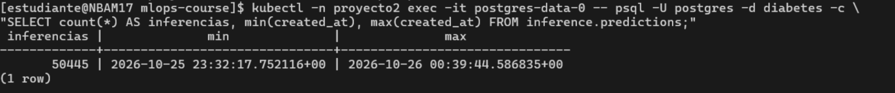

Cada fila guarda lo que pide el enunciado: `request_id`, fecha y hora, entrada recibida (JSONB, en
la columna `input`), predicción, probabilidad (y las de las tres clases), modelo, versión y alias,
tiempo del modelo y la réplica que atendió. En estas filas, de los últimos segundos de la prueba
con 300 usuarios, el tiempo del modelo (`ms`) sube a 430-770 ms por la contención de CPU que se
analiza en la prueba de carga:

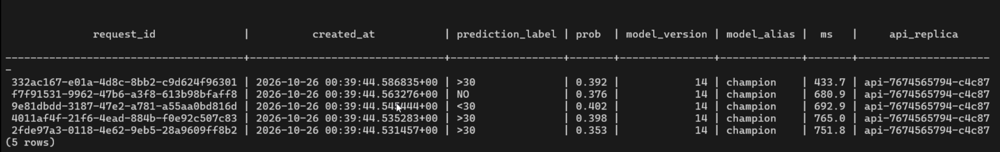

### 8. Interfaz gráfica (Streamlit)

En http://10.43.97.106:8007 la barra lateral muestra el modelo en producción (consultado a
`/model-info`) y botones para cargar ejemplos reales de cada clase. El formulario agrupa las
features de la capa clean:


Al predecir, Streamlit llama a la API (nunca a MLflow ni a la base de datos) y muestra la clase,
la probabilidad, la versión del modelo y la latencia:


### 9. Observabilidad (Prometheus)

En http://10.43.97.106:8009, **Status > Target health** muestra lo que recolecta Prometheus:

- **`api`:** una entrada por réplica de la API (aquí 3, con la API escalada), descubiertas solas
  con `kubernetes_sd_configs` gracias a la anotación `prometheus.io/scrape: "true"` de los pods.
  Cada una lleva los labels `pod` y `node`, así Grafana puede separar las métricas por réplica.
  Si se escala la API, las réplicas nuevas aparecen sin tocar la configuración.
- **`kubelet-cadvisor`:** el kubelet de cada nodo (`nodo-data` y `nodo-serving`, puerto 10250),
  del que salen la CPU, la memoria y el throttling por contenedor. Requiere los permisos del
  ServiceAccount definido en `observability/prometheus/k8s/rbac.yaml`.
- **`prometheus`:** sus propias métricas.

Todos los targets están en `UP`:

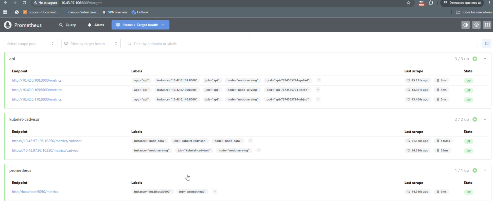

### 10. Prueba de carga

UI de Locust en http://10.43.97.106:8010. Locust corre como pod en `nodo-data` y apunta a
`http://api:8000`, el Service que reparte entre las dos réplicas de `nodo-serving`. En la
siguiente imagen, una prueba de humo con 10 usuarios: ~5,8 RPS (lo esperado con un `wait_time` de
1 a 2,5 s por usuario), 0 % de fallos, p50 ~70 ms y p95 ~160 ms.

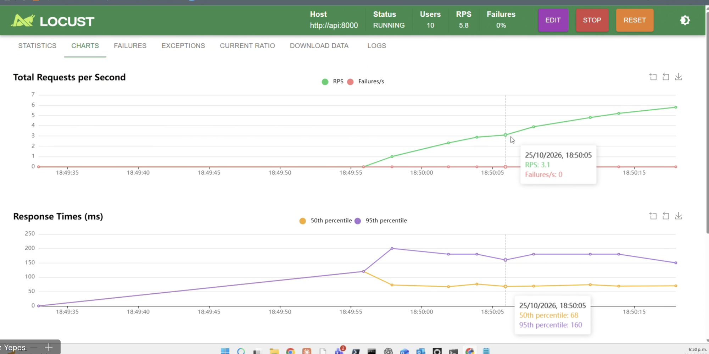

Para medir el límite se corre por niveles en modo headless (desde `.106`):

```bash
cd locust
./run_levels.sh 10 30 60 100 150 200 300
```

Cada nivel tiene rampa + 2 minutos estables y se anota en `locust/resultados/resumen.csv`
con usuarios, spawn rate, peticiones, exitosas, fallidas, latencia promedio, p50/p95/p99 y si
**cumple** el criterio (menos de 1 % de fallos y p95 menor a 500 ms, el mismo de taller_5).
El punto de degradación es el primer nivel que no cumple. Mientras corre, el dashboard de
Grafana (http://10.43.97.106:8008) muestra el efecto.

#### Resultados con 2 réplicas (1 CPU y 1 Gi cada una)

Spawn rate de 20 usuarios/s y 120 s estables por nivel (`locust/resultados/resumen.csv`):

| Usuarios | RPS | Peticiones | Exitosas | Fallidas | Promedio | p50 | p95 | p99 | Cumple |
|---|---|---|---|---|---|---|---|---|---|
| 10 | 5,5 | 658 | 658 | 0 | 78 ms | 63 ms | 130 ms | 330 ms | sí |
| 30 | 15,9 | 1.913 | 1.913 | 0 | 145 ms | 110 ms | 360 ms | 550 ms | sí |
| 60 | 26,7 | 3.215 | 3.215 | 0 | 504 ms | 390 ms | 1,2 s | 1,6 s | no |
| 100 | 28,7 | 3.456 | 3.456 | 0 | 1,7 s | 1,9 s | 3,1 s | 3,6 s | no |
| 150 | 28,1 | 3.379 | 3.379 | 0 | 3,6 s | 3,7 s | 5,0 s | 5,4 s | no |
| 200 | 29,9 | 3.592 | 3.592 | 0 | 4,9 s | 4,9 s | 6,3 s | 7,2 s | no |
| 300 | 32,3 | 3.878 | 3.878 | 0 | 7,5 s | 7,3 s | 8,7 s | 18 s | no |

Hasta 30 usuarios el sistema responde con holgura: el RPS crece en proporción a los usuarios y la
latencia se mantiene en cientos de milisegundos. En Grafana, CPU baja y casi ninguna petición en
cola:

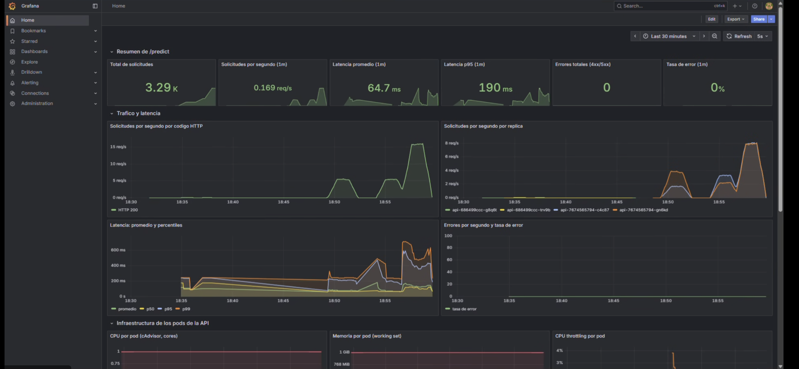

**Punto de degradación: entre 30 y 60 usuarios.** Con 60 usuarios el RPS (26,7) ya está cerca
del máximo y el p95 pasa de 360 ms a 1,2 s. Es el primer nivel que no cumple el criterio.

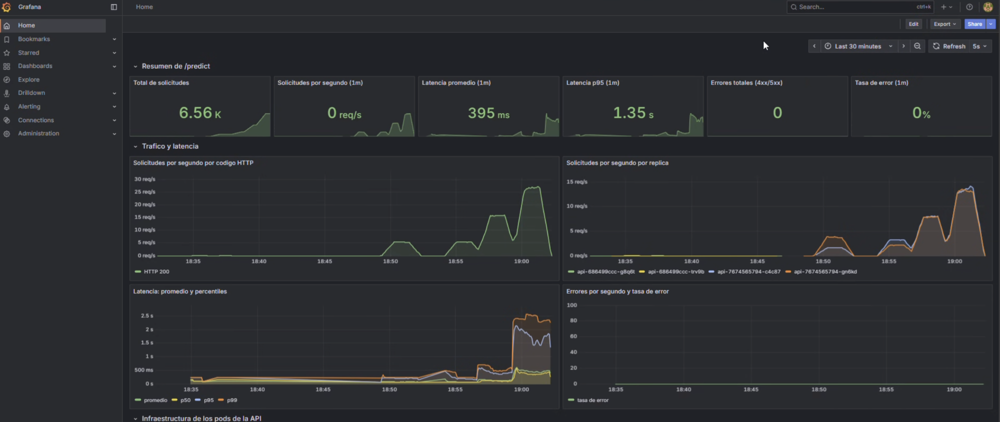

**Saturación: el techo es ~28-32 RPS.** De 60 a 300 usuarios (5 veces más) el RPS apenas sube de
26,7 a 32,3 y la latencia promedio crece de 0,5 a 7,5 s. Con la API al tope, agregar usuarios no
aumenta el throughput, solo alarga la fila: con 300 usuarios que esperan en promedio 1,75 s entre
peticiones y 7,5 s de respuesta, 300 / (1,75 + 7,5) ≈ 32 RPS (ley de Little), justo lo medido.

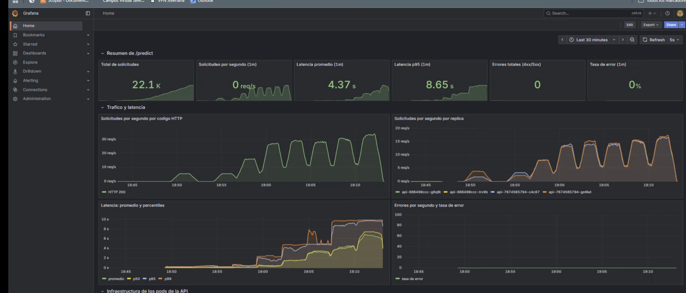

**El cuello de botella es la CPU de los pods de la API**, como muestran los paneles de
infraestructura con 300 usuarios:

- **CPU por pod (cAdvisor):** cada réplica trabaja a 0,75-0,95 de su límite de 1 CPU, y el
  throttling sube hasta ~13 %.
- **Peticiones en curso:** llegan a ~130 por réplica, esperando CPU.
- **Tiempo del modelo vs registro en BD:** el p95 de `predict_proba` sube de ~200 ms a ~2,4 s,
  mientras el `INSERT` en Postgres se mantiene alrededor de 0,5 s. Las peticiones compiten por la
  misma CPU para calcular el Random Forest; la base de datos no es el límite.
- **Memoria:** estable en ~400 MiB por réplica, lejos del límite de 1 Gi. No es un problema de
  memoria.

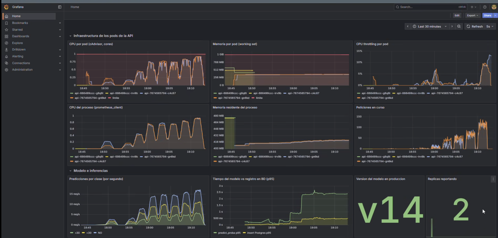

El generador de carga no limita la prueba: corre en otro nodo y 32 RPS es muy poco para un
proceso de Locust (maneja cientos); además, el throughput medido coincide con lo que predice la
saturación de la API. **No hubo errores (0 %)** en ningún nivel: Locust no corta por timeout y
la API siempre termina respondiendo bien, solo que más tarde. Con un cliente real que abandone a
los 2-3 s, los fallos empezarían alrededor de los 100 usuarios.

**Conclusión:** con 2 réplicas de 1 CPU, la API atiende con buena latencia hasta ~30 usuarios
concurrentes (~16 RPS) y su capacidad máxima es ~28-32 RPS, unos 15 RPS por réplica (~65 ms de
CPU por predicción). Para soportar más carga: más réplicas (o un HPA por CPU), más CPU por pod, o
un modelo más liviano (menos árboles o menos profundidad).

<details>
<summary>Capturas de Grafana de todos los niveles</summary>

| Nivel | Tráfico y latencia | Infraestructura |
|---|---|---|
| 10 usuarios | 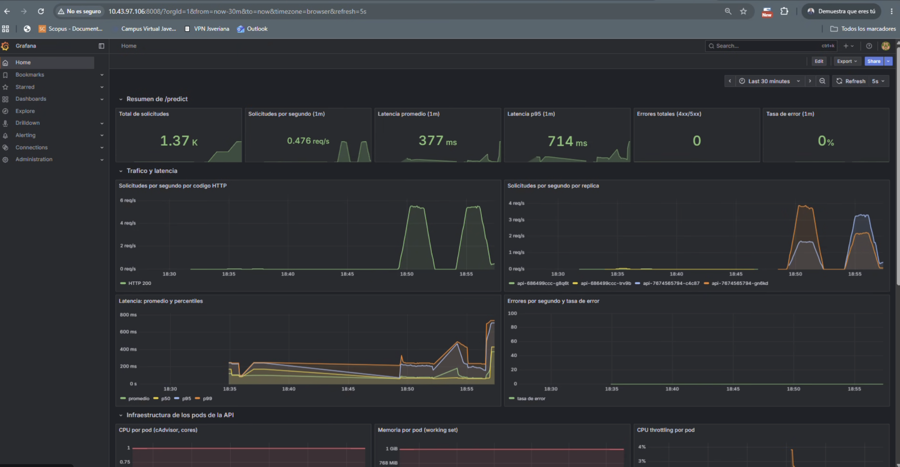 | |
| 30 usuarios |  | 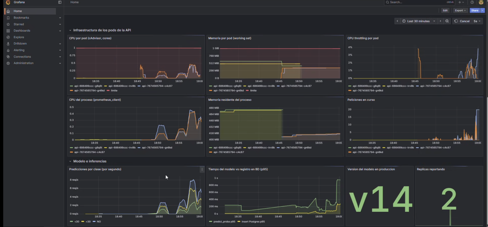 |
| 60 usuarios |  | 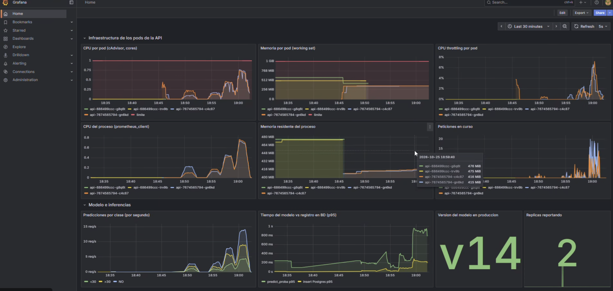 |
| 100 usuarios | 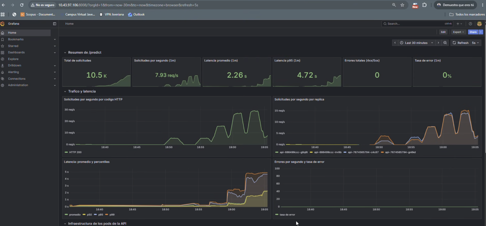 | 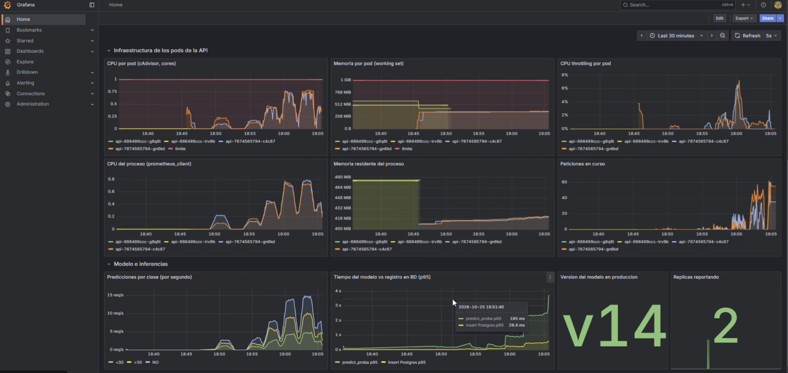 |
| 150 usuarios | 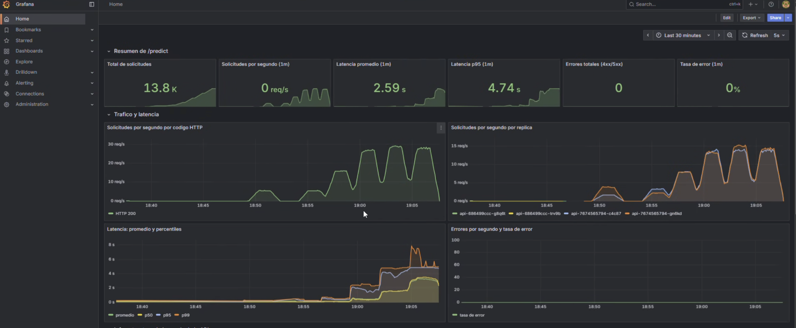 | 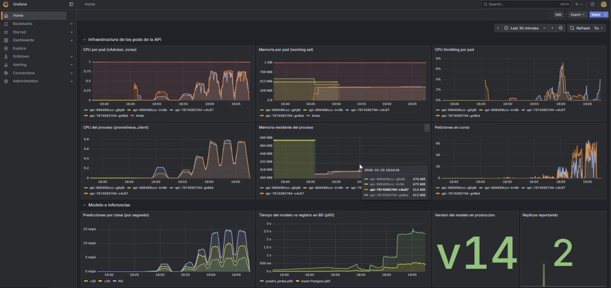 |
| 200 usuarios | 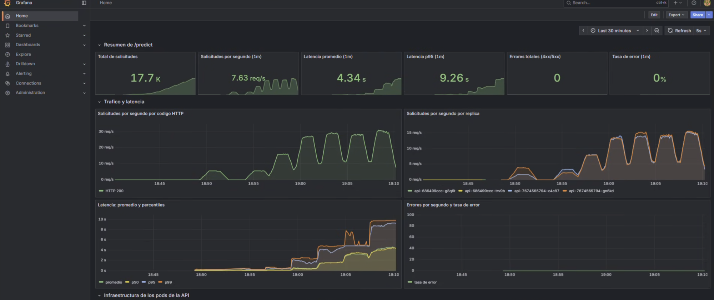 | 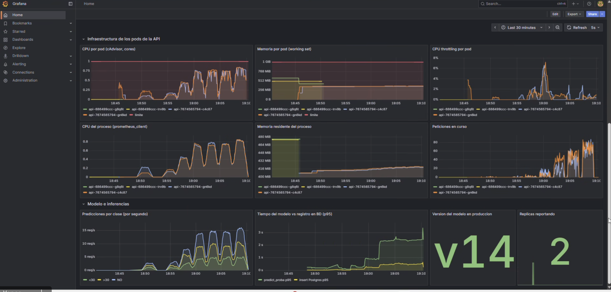 |
| 300 usuarios |  |  |

</details>

#### Comparación: 2 contra 3 réplicas

Para comprobar que el límite es la CPU por réplica, se escaló la API a 3 réplicas y se repitieron
los mismos niveles. `nodo-serving` tiene ~4 cores, así que las 3 réplicas (1 CPU de límite cada
una) caben sin que el nodo completo se vuelva el cuello de botella.

```bash
kubectl -n proyecto2 scale deployment api --replicas=3
./run_levels.sh 10 30 60 100 150 200 300
```

| Usuarios | RPS (2 rép.) | RPS (3 rép.) | p95 (2 rép.) | p95 (3 rép.) | Promedio (2 rép.) | Promedio (3 rép.) |
|---|---|---|---|---|---|---|
| 10 | 5,5 | 5,6 | 130 ms | 120 ms | 78 ms | 66 ms |
| 30 | 15,9 | 16,4 | 360 ms | 230 ms | 145 ms | 98 ms |
| 60 | 26,7 | 30,2 | 1,2 s | 660 ms | 504 ms | 240 ms |
| 100 | 28,7 | 40,9 | 3,1 s | 2,0 s | 1,7 s | 704 ms |
| 150 | 28,1 | 42,7 | 5,0 s | 3,2 s | 3,6 s | 1,8 s |
| 200 | 29,9 | 42,9 | 6,3 s | 4,2 s | 4,9 s | 2,9 s |
| 300 | 32,3 | 42,5 | 8,7 s | 7,0 s | 7,5 s | 5,3 s |

En ambos casos hubo 0 fallos en todos los niveles.

- **El techo sube en proporción a las réplicas:** de ~28-32 RPS a **~42-43 RPS**, un 50 % más
  con un 50 % más de réplicas. Cada réplica sigue atendiendo ~14 RPS. La API escala
  horizontalmente y el límite es la CPU de cada pod.
- **Mejor latencia en todos los niveles:** con 60 usuarios el p95 baja de 1,2 s a 660 ms, y con
  100 usuarios el promedio pasa de 1,7 s a 0,7 s.
- **El punto de degradación se mueve, pero no desaparece:** 30 usuarios cumplen en los dos casos
  y 60 no, aunque con 3 réplicas queda mucho más cerca del criterio (660 ms frente a 1,2 s). Con
  3 réplicas el límite cómodo está alrededor de 50 usuarios.
- **La ley de Little vuelve a cuadrar:** 300 / (1,75 + 5,3) ≈ 42,5 RPS, lo medido.

En Grafana (última hora) se ven las dos corridas: a la izquierda con 2 réplicas, techo en ~30
req/s; a la derecha con 3, techo en ~43 req/s, la carga repartida entre tres series en
"Solicitudes por segundo por réplica", y el panel "Réplicas reportando" en 3:

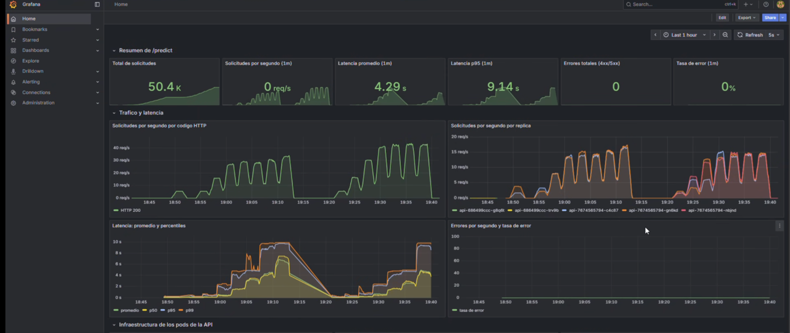

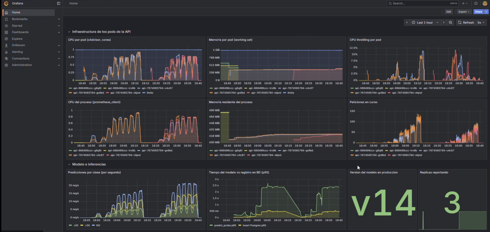

Con 3 réplicas cada pod sigue trabajando cerca de su límite de 1 CPU, y la memoria sigue estable
en ~400 MiB. Para atender más usuarios con latencias de cientos de milisegundos haría falta seguir
escalando (por ejemplo, un HPA que agregue réplicas cuando la CPU pase del 70 %) o bajar el costo
de cada predicción.

## Decisiones técnicas

### Capas de datos

Una instancia `postgres-data` con la base `diabetes` y tres **schemas** con dueños distintos:

| Schema | Escribe | Lee |
|---|---|---|
| `raw` | `airflow_etl` | `airflow_etl` |
| `clean` | `airflow_etl` | `airflow_etl` |
| `inference` | `api_writer` | `api_writer`, `airflow_etl` (para futuros reentrenamientos) |

La separación es lógica y de permisos (la API no puede tocar raw/clean y Airflow no puede
escribir inferencias)

`raw.diabetes` guarda las 50 columnas como texto, sin transformar, más `row_hash` (PK),
`batch_id`, `load_timestamp`, `source_file`, `source_row`, `status` y `status_reason`.
`raw.batches` lleva el control de cada lote.

### Limpieza y features

Documentadas en [notebooks/eda.ipynb](notebooks/eda.ipynb). En resumen: se eliminan `weight`,
`payer_code` e IDs; se excluyen encuentros de pacientes fallecidos o en hospicio; los IDs de
admisión/alta/origen y la especialidad se agrupan; los diagnósticos ICD-9 se agrupan en 9
categorías; de 23 medicamentos se conservan 7 y se crean `diabetes_meds_active` y
`diabetes_meds_changed`. El split es **por paciente** (hash de `patient_nbr`, 70/15/15), estable
entre ejecuciones y sin fuga entre train y test.

### Modelos y métrica

Se entrenan en paralelo `LogisticRegression`, `RandomForestClassifier` y
`HistGradientBoostingClassifier`, todos con pesos balanceados. **Métrica de selección: F1
macro en validación**, porque da el mismo peso a las tres clases y la readmisión temprana
(~11 %) es la más relevante clínicamente; accuracy premiaría predecir siempre `NO`. Se registran
también F1 y recall por clase, F1 weighted, ROC-AUC OvR, matriz de confusión y reporte de
clasificación.

`t09` (Airflow) re-evalúa el `champion` vigente sobre el **mismo** split de validación actual y `t10`
solo lo reemplaza si el mejor candidato lo supera. El mejor candidato de cada ejecución queda
con el alias `challenger`.

### Carga del modelo en la API

El modelo se carga al arrancar y un hilo consulta el alias `champion` cada 60 s
(`MODEL_REFRESH_SECONDS`); solo descarga de MLflow cuando la versión cambió. `/predict` nunca
llama a MLflow, y un nuevo champion entra sin redeploy. `POST /reload` fuerza la revisión.
Mientras no exista un champion, `/predict` responde 503 y `/model-info` lo explica.

### Métricas expuestas por la API

| Métrica | Tipo |
|---|---|
| `http_requests_total{method,endpoint,status}` | Counter |
| `http_request_duration_seconds{method,endpoint}` | Histogram |
| `http_requests_in_progress` | Gauge |
| `predictions_total{prediction_label,model_version}` | Counter |
| `prediction_errors_total{reason}` | Counter |
| `model_inference_duration_seconds` | Histogram |
| `inference_log_duration_seconds` | Histogram |
| `model_info{model_name,model_version,alias}` | Gauge |
| `process_cpu_seconds_total`, `process_resident_memory_bytes` | automáticas |

El dashboard **Proyecto 2 - API de inferencia** (`observability/grafana/dashboards/proyecto2-api.json`)
tiene total de solicitudes, RPS, latencia promedio, p50/p95/p99, errores, tasa de error, CPU,
memoria y throttling por pod (cAdvisor), predicciones por clase, tiempo del modelo vs tiempo del
insert en Postgres y versión del modelo activa.
