# Taller 6 - Pruebas unitarias y CI/CD con GitHub Actions

API en **FastAPI** que estima el **precio de una vivienda en Bogotá** a
partir de cuatro datos que escribe un usuario. Antes de estimar el precio, la
entrada pasa por un **preprocesamiento** de tres funciones (limpieza de texto,
validación de rangos y transformación de features), que es lo que se prueba
con **pytest**. Las pruebas corren dentro de un contenedor, sin intervención
manual, y exigen una **cobertura mínima del 90 %**.

El taller tiene dos actividades:

1. **Pruebas unitarias**: la API,
   las pruebas, la cobertura y el `Dockerfile` que ejecuta `pytest`.
2. **GitHub Actions**: un workflow que corre las
   pruebas en cada Pull Request y, al hacer merge a `master`, publica la imagen
   en Docker Hub.

## El problema

Un usuario quiere saber cuánto podría valer un apartamento. Envía:

| Campo          | Tipo  | Ejemplo          | Regla                          |
|----------------|-------|------------------|--------------------------------|
| `barrio`       | texto | `"  Chapinero "` | no vacío                       |
| `area_m2`      | número| `80`             | entre 20 y 1000 m²             |
| `habitaciones` | entero| `3`              | entre 1 y 10                   |
| `estrato`      | entero| `4`              | entre 1 y 6                    |

Los datos que escribe una persona llegan "sucios": con espacios de más,
mayúsculas, tildes o valores imposibles (estrato 9, área de 5 m²). Si esos
datos llegan así al modelo, la predicción es basura o el servicio se cae. Por
eso el preprocesamiento limpia, valida y transforma **antes** de llamar al
modelo, y las pruebas unitarias garantizan que esas reglas no se rompan con
cambios futuros.

## Arquitectura

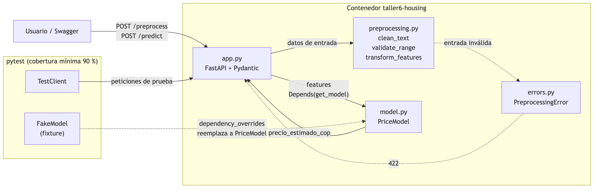

Flujo de una petición a `/predict`:

1. FastAPI valida los **tipos** con Pydantic (por ejemplo, `area_m2` debe ser número).
2. `transform_features` limpia el barrio, valida los **rangos** y calcula las features.
3. Si algo es inválido, el preprocesamiento lanza un **error propio** (`OutOfRangeError`,
   `NotNumericError` o `EmptyTextError`), la API responde **422** indicando el tipo de
   error y el campo, y el modelo **no** se llama.
4. Si todo está bien, el modelo (`PriceModel`) recibe las features y devuelve el precio.

## Cálculos

### 1. `clean_text(texto, nombre)` - limpieza de texto

1. Si el texto es `None`, vacío o solo espacios, lanza `EmptyTextError` (por ejemplo `"barrio no puede estar vacío"`).
2. Quita las tildes (normalización Unicode NFKD y descarte de los caracteres no ASCII).
3. Pasa a minúsculas.
4. Elimina los espacios al inicio y al final, y deja un solo espacio entre palabras.

| Entrada            | Salida            |
|--------------------|-------------------|
| `"  Chapinero "`   | `"chapinero"`     |
| `"USAQUÉN"`        | `"usaquen"`       |
| `"Santa   Bárbara"`| `"santa barbara"` |
| `"   "`            | `EmptyTextError`  |

### 2. `validate_range(valor, min, max, nombre)` - validación de rangos

Devuelve el valor si cumple `min <= valor <= max` (los **límites se aceptan**).
Si no es numérico (`"80"`, `None` o `True`) lanza `NotNumericError`; si está
fuera del rango lanza `OutOfRangeError`.

| Variable       | Mínimo | Máximo |
|----------------|--------|--------|
| `area_m2`      | 20     | 1000   |
| `habitaciones` | 1      | 10     |
| `estrato`      | 1      | 6      |

### 3. `transform_features(barrio, area_m2, habitaciones, estrato)` - transformación

Usa las dos funciones anteriores y luego calcula:

| Feature               | Cálculo                                                   |
|-----------------------|-----------------------------------------------------------|
| `barrio`              | `clean_text(barrio)`                                      |
| `area_por_habitacion` | `round(area_m2 / habitaciones, 2)`                        |
| `es_apretado`         | `area_por_habitacion < 20`                                |
| `es_estrato_alto`     | `estrato >= 5`                                            |
| `factor_zona`         | según el barrio limpio (tabla abajo); `1.0` si no se conoce |

| Barrio        | `factor_zona` |
|---------------|---------------|
| chapinero     | 1.20          |
| usaquen       | 1.15          |
| teusaquillo   | 1.05          |
| suba          | 0.95          |
| kennedy       | 0.85          |
| bosa          | 0.80          |
| otro          | 1.00          |

### Errores propios (`errors.py`)

En lugar de lanzar `ValueError` genéricos, el preprocesamiento lanza errores
propios que heredan de una clase base. Cada error guarda el **campo** que
falló y, cuando aplica, el **valor** recibido y los **límites**, así que quien
lo captura sabe exactamente qué pasó sin tener que interpretar el texto.

```text
PreprocessingError (field, message, to_dict())
├── EmptyTextError    texto vacío o solo espacios
├── NotNumericError   valor no numérico (guarda value)
└── OutOfRangeError   fuera de [min, max] (guarda value, min_value, max_value)
```

La API registra un `exception_handler` para `PreprocessingError`: cualquier
error de esa familia se convierte en una respuesta **422** con
`{"detail": {"error": ..., "field": ..., "message": ...}}`. Así los endpoints
no necesitan `try/except` y un error nuevo que herede de la base se maneja
solo.

### 4. Modelo de precio (`PriceModel`)

Es un modelo de reglas que hace el papel del modelo entrenado. Precio por m²
base según el estrato:

| Estrato | Precio por m² (COP) |
|---------|---------------------|
| 1       | 2.000.000           |
| 2       | 2.800.000           |
| 3       | 3.800.000           |
| 4       | 5.000.000           |
| 5       | 6.500.000           |
| 6       | 8.000.000           |

```text
precio = area_m2 × precio_m2[estrato] × factor_zona
si es_apretado: precio = precio × 0.95
```

**Ejemplo:** `{"barrio": "  Chapinero ", "area_m2": 80, "habitaciones": 3, "estrato": 4}`

```text
barrio              = "chapinero"           factor_zona = 1.20
area_por_habitacion = 80 / 3 = 26.67        es_apretado = False (26.67 >= 20)
precio              = 80 × 5.000.000 × 1.20 = 480.000.000 COP
```

## Pruebas

Hay **36 pruebas** (contando cada caso de `@pytest.mark.parametrize`) en tres archivos:

| Archivo                 | Qué prueba                                                                                                              |
|-------------------------|------------------------------------------------------------------------------------------------------------------------|
| `test_preprocessing.py` | Casos normales, **bordes** (área 20 y 1000, `area_por_habitacion` exactamente 20, barrio desconocido) y **errores** con `pytest.raises` |
| `test_model.py`         | El cálculo del precio en un solo test parametrizado con nombre por caso (`caso_normal`, `apretado_con_descuento`, `barrio_desconocido`) y que `get_model` devuelva siempre la misma instancia |
| `test_api.py`           | Los endpoints con `TestClient`: 200 en los casos válidos, 422 por rango o tipo inválido                                |

### Aislar el modelo con un fixture

`/predict` recibe el modelo con `Depends(get_model)`. En `tests/conftest.py`
el fixture `client` reemplaza esa dependencia por un `FakeModel` que siempre
devuelve `123.0` y guarda las features que recibió:

```python
app.dependency_overrides[get_model] = lambda: fake_model
```

Así las pruebas de la API no dependen del modelo real, que en un proyecto
real sería un `.pkl` o un modelo descargado de MLflow. 

### Cobertura mínima del 90 %

Toda la configuración está en `pyproject.toml`. Las dependencias de la API
van en `dependencies` y las de pruebas (`pytest`, `pytest-cov`, `httpx` para
`TestClient`) en el grupo `dev`. La sección de pytest hace que **todo**
`pytest` mida la cobertura y falle si no llega al 90 %, y la de coverage
excluye la carpeta `tests/` para medir solo el código de la aplicación:

```toml
[dependency-groups]
dev = ["anyio==4.9.0", "httpx==0.28.1", "pytest==8.3.5", "pytest-cov==6.1.1"]

[tool.pytest.ini_options]
testpaths = ["tests"]
pythonpath = ["."]
addopts = "-v --cov=. --cov-report=term-missing --cov-fail-under=90"

[tool.coverage.run]
omit = ["tests/*"]
```

En el `Dockerfile` se copia el binario de `uv` y se instalan las dependencias
junto con el grupo `dev`:

```dockerfile
COPY --from=ghcr.io/astral-sh/uv:latest /uv /bin/uv
RUN uv pip install --system --no-cache -r pyproject.toml --group dev
```

## Paso a paso

### 1. Construir la imagen

```bash
cd taller_6/unit_testing
docker build -t taller6-housing:1.0.0 .
```

### 2. Ejecutar las pruebas en el contenedor

```bash
docker run --rm taller6-housing:1.0.0
```

El `CMD` del `Dockerfile` es `pytest`, así que el contenedor corre las pruebas
y termina solo. En la siguiente imagen se ve el final de la salida: la tabla
de cobertura con los cuatro módulos al **100 %**, el mensaje
`Required test coverage of 90% reached` y las **36 pruebas** en verde
(`36 passed`).

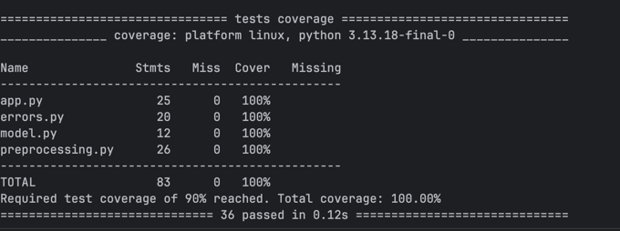

El código de salida es `0`, que es lo que mira un pipeline de CI para saber si
puede continuar:

```bash
docker run --rm taller6-housing:1.0.0 > /dev/null; echo "exit code: $?"
```

En la siguiente imagen se ve que, al descartar la salida de pytest, el
contenedor termina con `exit code: 0`, es decir, todas las pruebas pasaron y
la cobertura superó el 90 %.

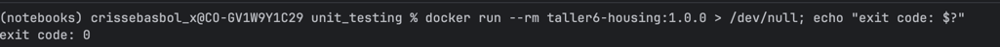

### 3. Probar la API desde Swagger

La misma imagen sirve la API si se cambia el comando:

```bash
docker run --rm -p 8022:8000 taller6-housing:1.0.0 \
  uvicorn app:app --host 0.0.0.0 --port 8000
```

Swagger queda en http://localhost:8022/docs.

En la siguiente imagen se ve la documentación de la API con sus tres
endpoints (`GET /health`, `POST /preprocess` y `POST /predict`) y el esquema
`Vivienda` que reciben los endpoints `POST`.

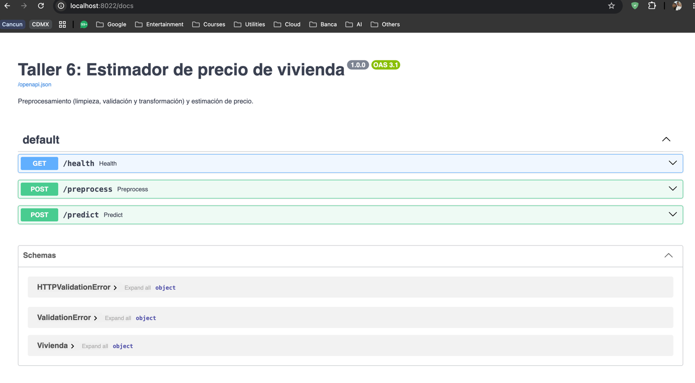

`POST /preprocess` con el ejemplo 1 devuelve las features calculadas.

En la siguiente imagen se ve la petición enviada desde Swagger, con el barrio
escrito con espacios y mayúscula (`"  Chapinero "`), y la respuesta `200`:
el barrio limpio (`chapinero`), `area_por_habitacion = 26.67`,
`es_apretado = false` (26.67 ≥ 20), `es_estrato_alto = false` (estrato 4) y
`factor_zona = 1.2`.

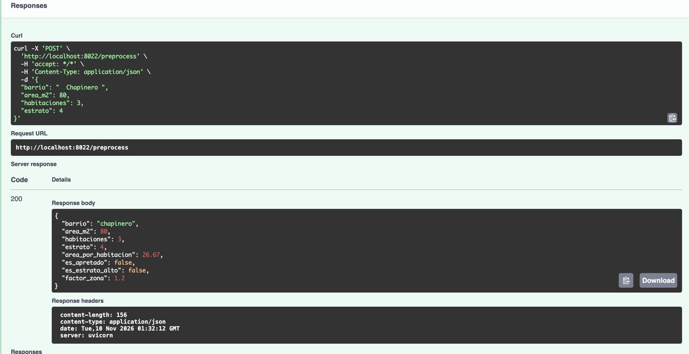

`POST /predict` con el mismo cuerpo devuelve las features, el precio
estimado y la versión del modelo.

En la siguiente imagen se ve la respuesta `200`: las mismas features de
`/preprocess`, `precio_estimado_cop = 480000000` y `modelo = reglas-1.0`. El
precio coincide con el cálculo del ejemplo 1
(80 m² × 5.000.000 × 1.20 = 480.000.000 COP, sin descuento porque no es apretado).

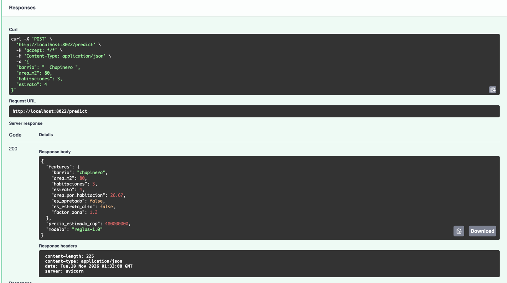

Si se envía un valor fuera de rango (por ejemplo `"estrato": 9`), la API
responde **422** con el error propio que lanzó `validate_range`.

En la siguiente imagen se ve la respuesta `422 Unprocessable Content` con el
`detail` que arma el `exception_handler`: el tipo de error
(`OutOfRangeError`), el campo que falló (`estrato`) y el mensaje con el rango
permitido y el valor recibido. El modelo no se llama.

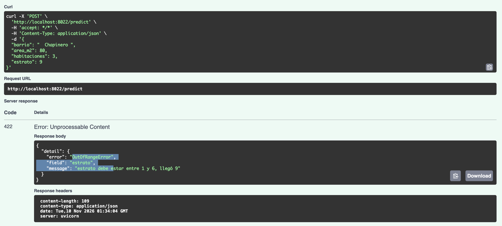

### 4. Evidencia: falla si la cobertura no llega al 90 %

Para mostrar que la condición de cobertura funciona, se ejecutan **solo** las
pruebas de preprocesamiento. Así `app.py` y `model.py` quedan sin probar:

```bash
docker run --rm taller6-housing:1.0.0 pytest tests/test_preprocessing.py
echo "exit code: $?"
```

Las 26 pruebas pasan, pero la cobertura total baja a **87 %** (`app.py` 80 %,
`model.py` 58 %). Pytest termina con
`FAIL Required test coverage of 90% not reached. Total coverage: 86.75%` y
código de salida **1**. Es decir: aunque ninguna prueba falle, el pipeline se
detiene porque falta probar código.

En la siguiente imagen se ve la última prueba en `PASSED`, seguida de
`ERROR: Coverage failure: total of 87 is less than fail-under=90`; la tabla
con las líneas sin cubrir de `app.py` y `model.py` en la columna `Missing`;
el resumen `26 passed`, y al final `exit code: 1`.

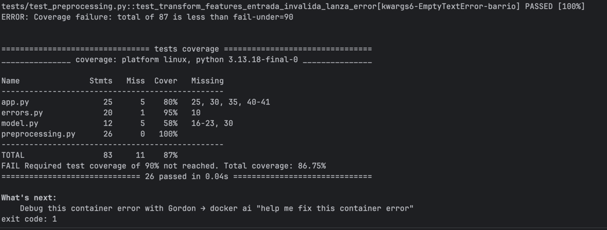

### 5. Evidencia: un cambio en el código rompe las pruebas

Se simulan dos cambios "accidentales" dentro de un contenedor desechable, sin
modificar el repositorio.

**Cambio en el preprocesamiento:** alguien decide que el estrato 4 ya es
"estrato alto" (`estrato >= 5` pasa a `estrato >= 4`):

```bash
docker run --rm taller6-housing:1.0.0 sh -c \
  "sed -i 's/estrato >= 5/estrato >= 4/' preprocessing.py && pytest"
echo "exit code: $?"
```

Falla `test_transform_features_caso_normal`, porque ahora
`es_estrato_alto` es `True` para el ejemplo de estrato 4. El resultado es
`1 failed, 35 passed` y el código de salida **1**.

En la siguiente imagen se ve el `AssertionError` con el diff que muestra
pytest: de las 8 features, 7 son iguales y la única diferente es
`{'es_estrato_alto': True} != {'es_estrato_alto': False}`, así que el cambio
se ubica de inmediato. La cobertura sigue al 100 %: el código está cubierto,
pero el **resultado** cambió, y eso es lo que detectan las aserciones.

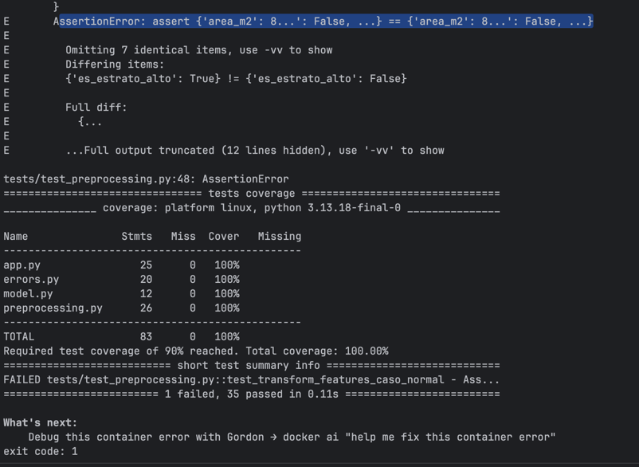

**Cambio en el modelo:** alguien baja el precio por m² del estrato 4 de
5.000.000 a 4.500.000:

```bash
docker run --rm taller6-housing:1.0.0 sh -c \
  "sed -i 's/4: 5_000_000/4: 4_500_000/' model.py && pytest"
echo "exit code: $?"
```

Falla `test_precio[caso_normal]` con
`assert 432000000.0 == 480000000 ± 4.8e+02`: pytest muestra el nombre del
caso, el valor obtenido y el esperado, así que el error se encuentra de
inmediato. Los otros casos de precio (`apretado_con_descuento`,
`barrio_desconocido`) siguen pasando porque no usan el estrato 4.

En la siguiente imagen se ve la línea del `assert` que falló, el valor
obtenido (`432000000.0`) contra el esperado (`480000000 ± 4.8e+02`, la
tolerancia de `pytest.approx`), y en el resumen
`FAILED tests/test_model.py::test_precio[caso_normal]`, donde el `id` del
parámetro indica qué caso se rompió. Termina con `1 failed, 35 passed` y
`exit code: 1`.

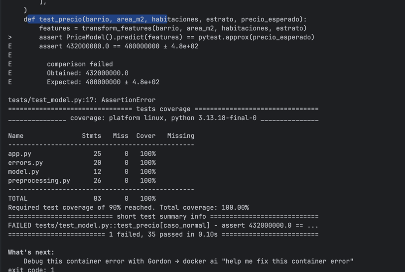

## Ejecutar local (sin contenedor)

```bash
cd taller_6/unit_testing
uv run pytest
uv run uvicorn app:app --reload --port 8022
```

## Actividad 2: GitHub Actions

El workflow está en `.github/workflows/taller6-ci-cd.yml`, en la raíz del
repositorio, porque GitHub solo lee los workflows de esa carpeta. Parte de la
plantilla del curso (`ci-cd-unit-tests-dockerhub.yml`) con estos ajustes:

| Variable / campo | Valor                              | Por qué                                              |
|------------------|------------------------------------|------------------------------------------------------|
| `paths`          | `taller_6/unit_testing/**` y el propio workflow | solo se ejecuta si cambia la app del taller 6 |
| `APP_PATH`       | `taller_6/unit_testing`            | carpeta donde están el `pyproject.toml` y los tests  |
| `IMAGE_NAME`     | `crissebasbol/taller6-housing`     | usuario/repositorio en Docker Hub                    |
| `PYTHON_VERSION` | `3.13`                             | la misma versión que la imagen (`python:3.13-slim`)  |
| rama             | `master`                           | la rama principal de este repositorio se llama `master`, no `main` |

### Flujo

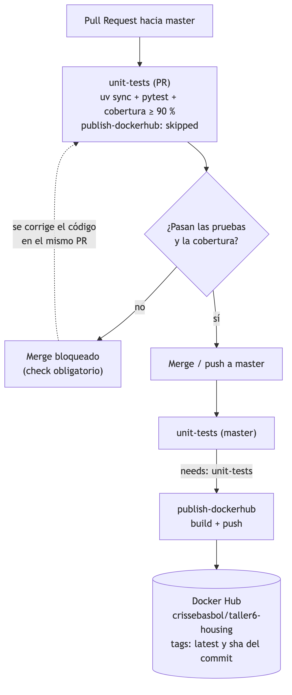

1. **`unit-tests`** corre en cada `pull_request` y en cada `push` a `master`
   que toque la carpeta del taller:
   - instala `uv` y Python 3.13 con `astral-sh/setup-uv`,
   - instala las dependencias con `uv sync --group dev` (las mismas del `pyproject.toml`),
   - ejecuta `uv run pytest`, que ya trae la regla de cobertura mínima del 90 %,
   - escribe la tabla de cobertura en el resumen del run (`$GITHUB_STEP_SUMMARY`),
     incluso si las pruebas fallan.
2. **`publish-dockerhub`** tiene `needs: unit-tests`, así que solo arranca si
   las pruebas pasaron, y la condición
   `github.event_name == 'push' && github.ref == 'refs/heads/master'` hace que
   solo publique después del merge, nunca desde un PR. Construye la imagen con
   el mismo `Dockerfile` de la actividad 1 y la sube con dos tags: `latest` y
   el SHA del commit.

### 1. Variable y secret en GitHub

En `Settings > Secrets and variables > Actions` se crean:

| Nombre               | Tipo         | Pestaña     | Valor                                                                 | Uso en el workflow                  |
|----------------------|--------------|-------------|-----------------------------------------------------------------------|-------------------------------------|
| `DOCKERHUB_USERNAME` | **Variable** | `Variables` | el usuario de Docker Hub (`crissebasbol`)                             | `${{ vars.DOCKERHUB_USERNAME }}`    |
| `DOCKERHUB_TOKEN`    | **Secret**   | `Secrets`   | un Access Token de Docker Hub (`Account settings > Personal access tokens`) con permiso de lectura y escritura | `${{ secrets.DOCKERHUB_TOKEN }}` |

El usuario no es información sensible (ya aparece en el nombre de la imagen),
así que va como **variable**: se puede leer en la configuración y en los logs.
El token sí da acceso a la cuenta, así que va como **secret**: GitHub lo
guarda cifrado, no se puede volver a ver después de creado y aparece como
`***` en los logs.

En la siguiente imagen se ve la variable `DOCKERHUB_USERNAME` en
`Repository variables`. Su valor (`crissebasbol`) se muestra en claro.

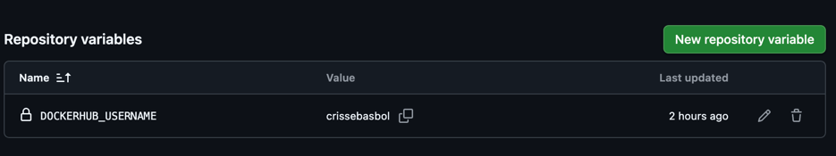

En la siguiente imagen se ve el secret `DOCKERHUB_TOKEN` en
`Repository secrets`. A diferencia de la variable, GitHub no muestra su valor,
solo el nombre y la fecha de la última actualización.

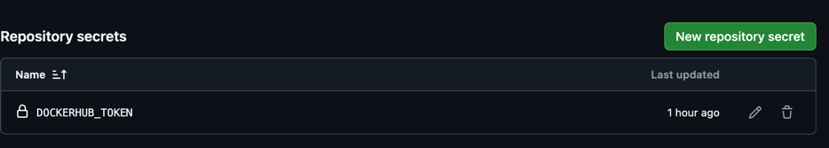

### 2. Pull Request: se ejecutan las pruebas

Al abrir un PR hacia `master` con cambios en `taller_6/unit_testing/`, se
ejecuta solo el job `unit-tests`. `publish-dockerhub` aparece como **skipped**
porque el evento es `pull_request`.

En la siguiente imagen se ven los checks del PR: `unit-tests (pull_request)`
en verde (11 s) y `publish-dockerhub (pull_request)` como **skipped**. El
merge aparece bloqueado, pero no por las pruebas: la rama `master` ya exige
al menos una revisión aprobada antes de hacer merge.

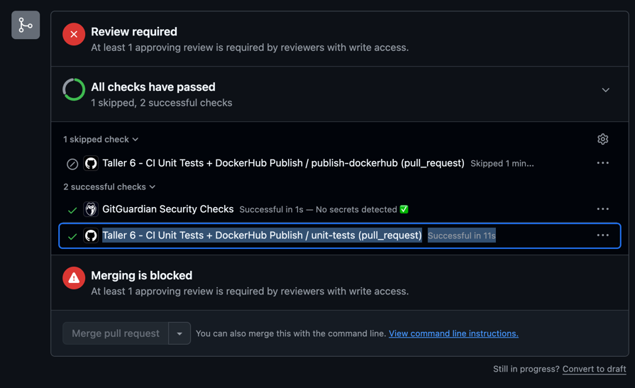

En la siguiente imagen se ven los pasos del job `unit-tests`, todos en verde:
`Set up uv`, `Install dependencies`, `Run unit tests (cobertura mínima 90 %)`
y `Coverage summary`. Este último, expandido, muestra el comando que escribe
la tabla de cobertura en el resumen del run y las variables del workflow
(`APP_PATH`, `IMAGE_NAME`, `PYTHON_VERSION`).

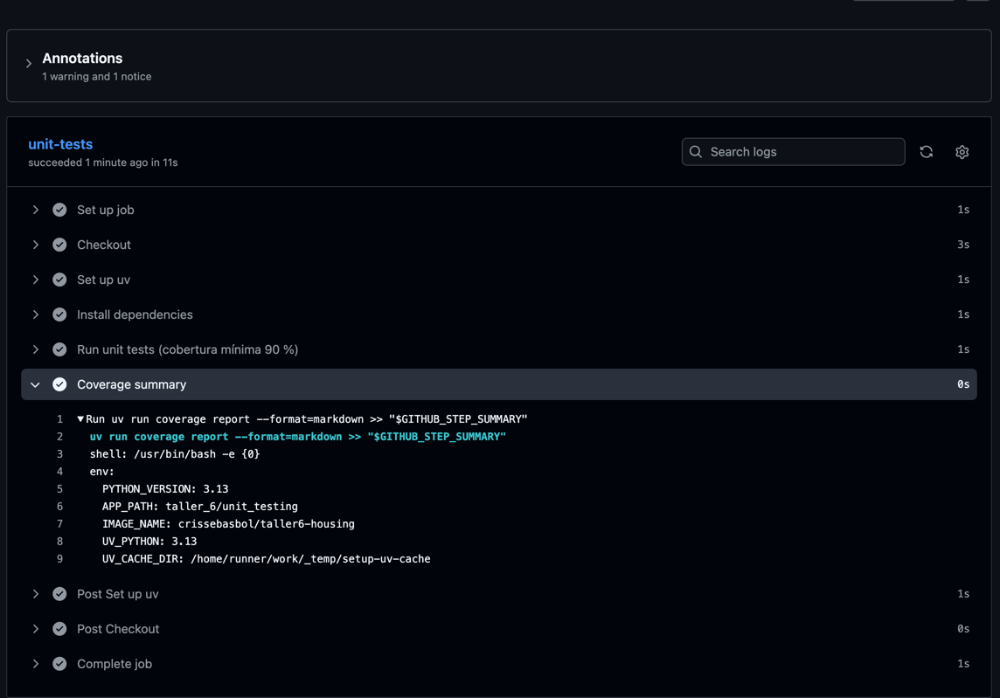

En la siguiente imagen se ve el resumen del run: el grafo
`unit-tests → publish-dockerhub` (este último omitido por ser un PR) y la
tabla de cobertura generada por `coverage report --format=markdown`, con los
cuatro módulos al 100 %.

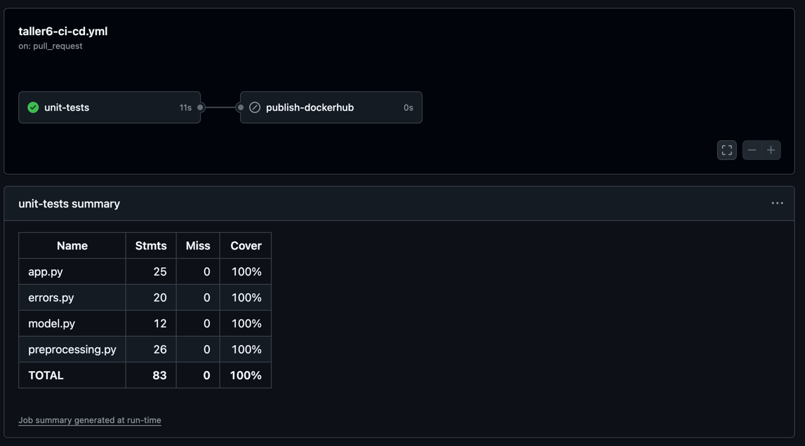

### 3. Merge a `master`: se publica la imagen

Al hacer merge del PR, el `push` a `master` vuelve a ejecutar `unit-tests` y,
como pasa, se ejecuta `publish-dockerhub`.

Run del merge: https://github.com/crissebasbol/mlops-course/actions/runs/42750453707

En la siguiente imagen se ve el run disparado por el `push` del commit
`4eaf257` en `master`, con estado **Success** en 54 s: `unit-tests` (14 s)
y luego `publish-dockerhub` (35 s), los dos en verde. Debajo está otra vez la
tabla de cobertura al 100 %.

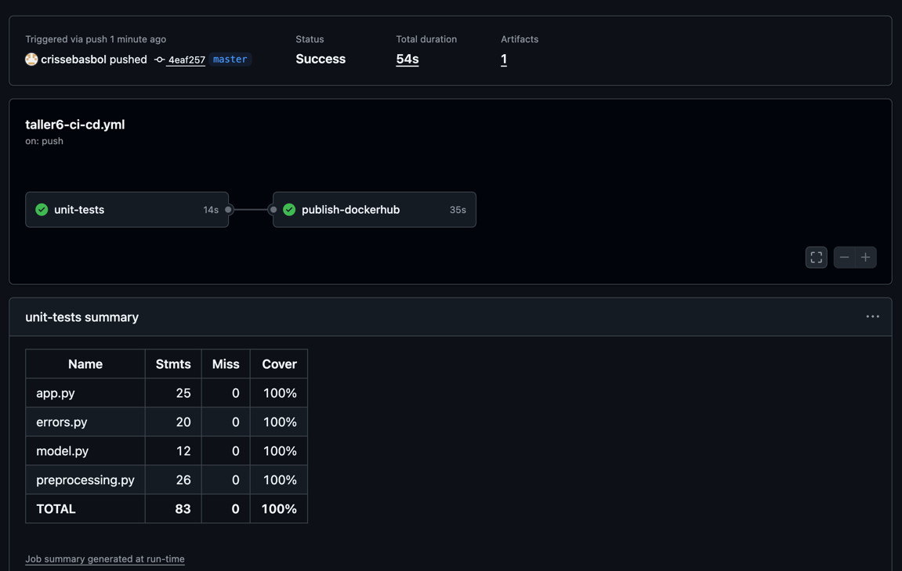

En la siguiente imagen se ve el resumen que deja `docker/build-push-action`:
el build del contexto `taller_6/unit_testing` completado en 13 s, con
`push: true` y los dos tags publicados, `latest` y el SHA completo del commit
(`4eaf25767bb25386a2efdace7a6773c56e5606fe`).

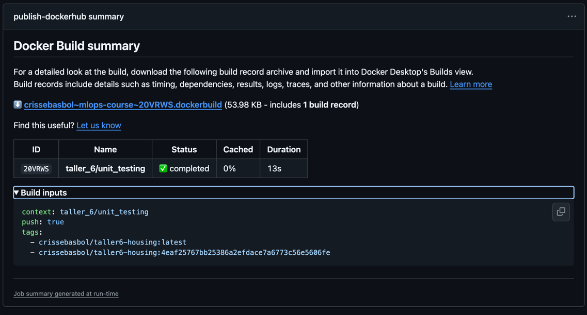

La imagen queda en Docker Hub con los tags `latest` y el SHA del commit:
https://hub.docker.com/r/crissebasbol/taller6-housing/tags

En la siguiente imagen se ve la página de tags del repositorio
`crissebasbol/taller6-housing`: los tags `4eaf2576...` y `latest` publicados
por `crissebasbol`, para `linux/amd64` y con 63 MB comprimidos. Los dos
apuntan al mismo digest (`050be6c68e59`), es decir, son la misma imagen con
dos nombres.

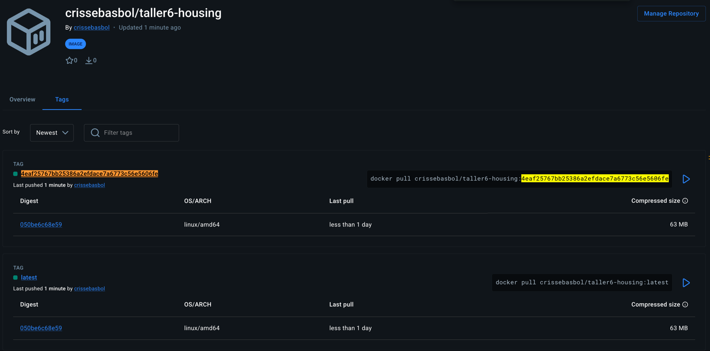

La imagen publicada es la misma de la actividad 1, así que se puede descargar
y correr las pruebas o la API sin construir nada:

```bash
docker run --rm crissebasbol/taller6-housing:latest
docker run --rm -p 8022:8000 crissebasbol/taller6-housing:latest \
  uvicorn app:app --host 0.0.0.0 --port 8000
```

### 4. Reto: una prueba que falla bloquea el merge

Para que un check en rojo **impida** el merge hay que volverlo obligatorio:

- activar **Require a pull request before merging**,
- activar **Require status checks to pass before merging** y agregar el check `unit-tests`.

Se usó un **ruleset** (`Settings > Rules > Rulesets`) llamado `master`. En la
siguiente imagen se ve que está en estado **Active** y sin nadie en la
`Bypass list`, así que la regla aplica a todos, incluido el dueño del
repositorio.

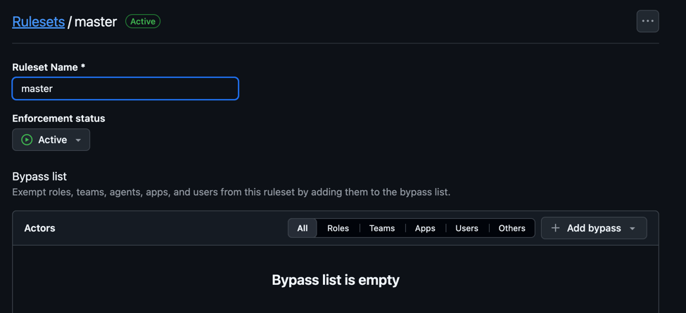

En la siguiente imagen se ve la opción **Require status checks to pass**
activada, con `unit-tests` (de GitHub Actions) como check obligatorio. El
nombre coincide con el `id` del job en el workflow.

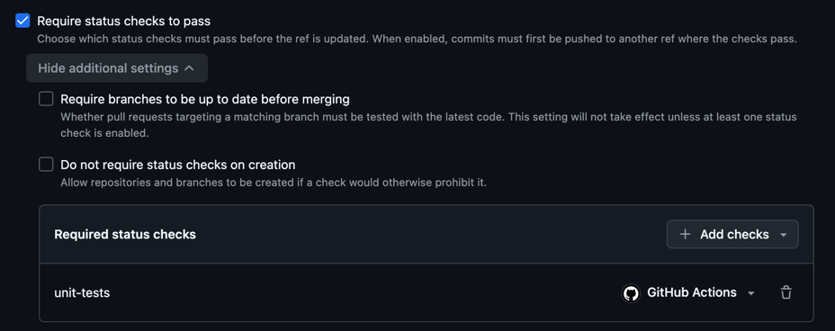

Luego se abre un PR con un cambio que rompe una prueba, por ejemplo bajar el
precio por m² del estrato 4 en `model.py`:

```python
PRECIO_M2_POR_ESTRATO = {
    ...
    4: 4_500_000,
    ...
}
```

El job `unit-tests` falla en `test_precio[caso_normal]`
(`assert 432000000.0 == 480000000 ± 4.8e+02`) y el botón de merge queda
bloqueado con el mensaje de que los checks requeridos no pasaron.

PR del reto: https://github.com/crissebasbol/mlops-course/pull/57

En la siguiente imagen se ve el log del paso `Run unit tests (cobertura mínima 90 %)`
en GitHub Actions: la cobertura sigue al 100 %, pero falla
`tests/test_model.py::test_precio[caso_normal]` con el valor obtenido
(`432000000.0`) contra el esperado (`480000000 ± 4.8e+02`). Termina con
`1 failed, 35 passed` y `Error: Process completed with exit code 1.`, lo que
marca el job en rojo.

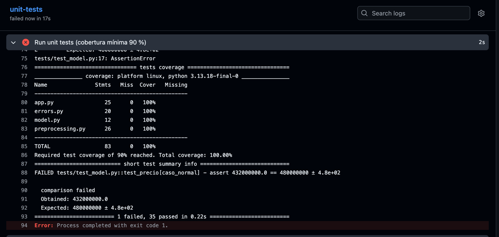

En la siguiente imagen se ve el PR con la revisión **aprobada** (`Changes approved`),
así que el único motivo del bloqueo es el check: `unit-tests (pull_request)`
aparece en rojo con la etiqueta **Required**, `publish-dockerhub` como skipped,
y el botón `Merge pull request` deshabilitado con el mensaje
**"Merging is blocked due to failing merge requirements"**.

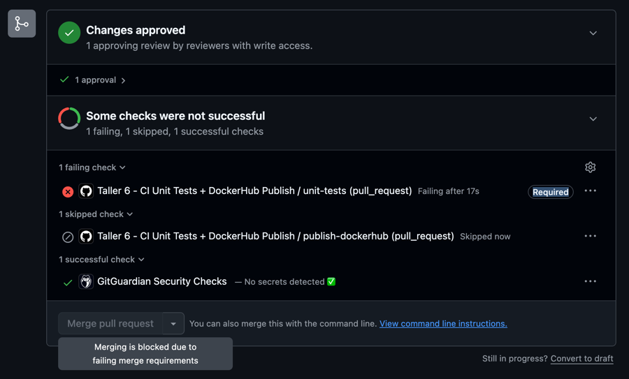
